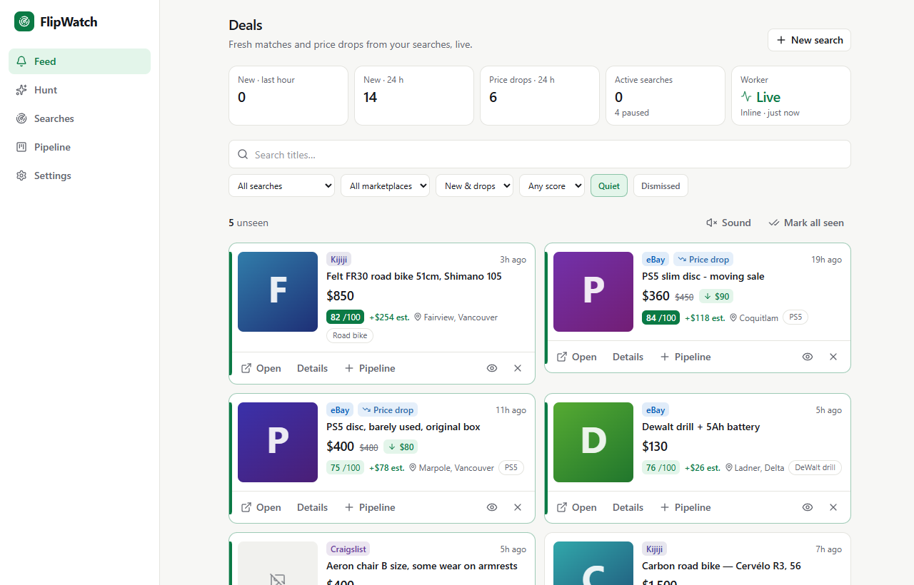
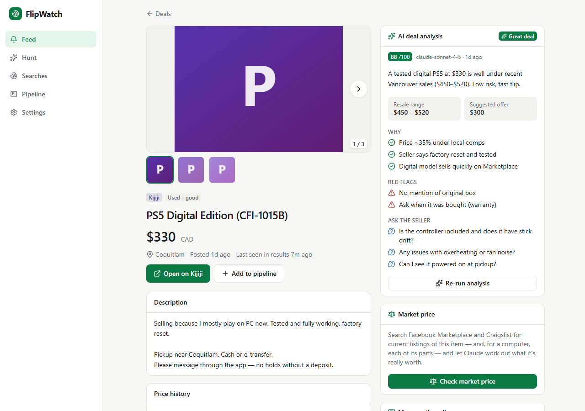
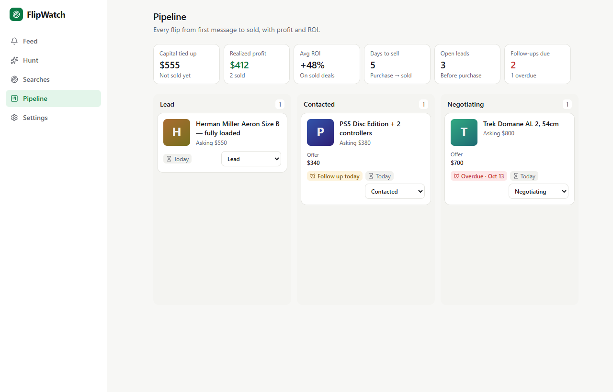
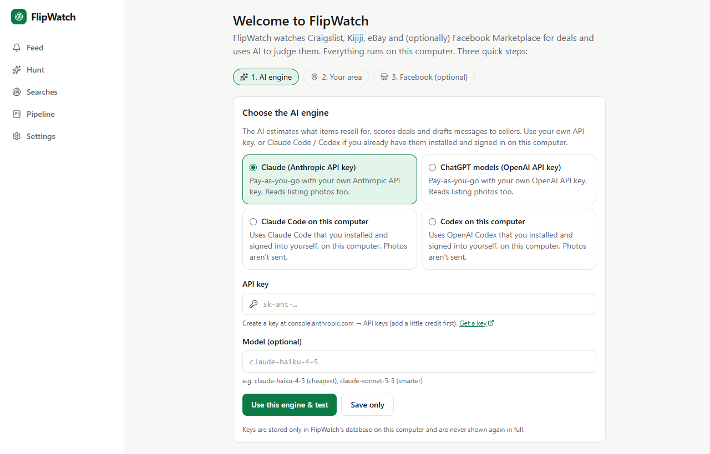
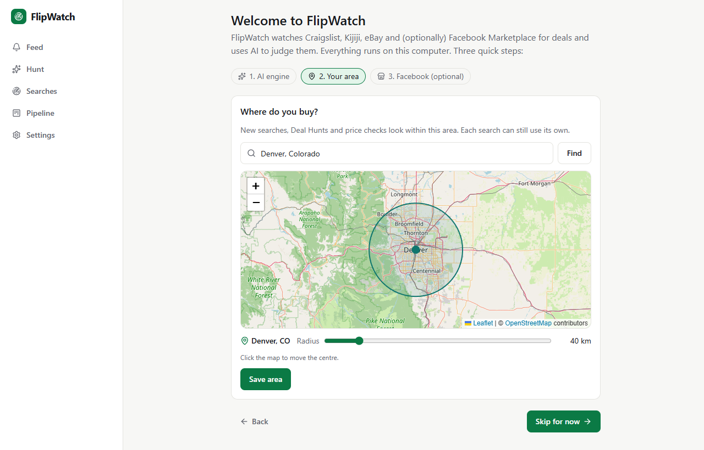

# FlipWatch

**Find underpriced deals on local marketplaces before anyone else — on your own computer.**

FlipWatch watches Craigslist, Kijiji, eBay, OfferUp and (optionally) Facebook Marketplace for the things you
want, alerts you the moment a good deal appears, and uses AI to tell you what it's really worth.

- **Saved searches** — keywords, price range, your area and radius; checked every few minutes.
- **Instant alerts** — Discord, Telegram, Slack, ntfy (free phone push), email, browser push.
- **AI deal analysis** — estimated resale value, a fair offer, red flags, questions to ask, and a drafted
  message to the seller.
- **Market price checks** — the AI identifies the item (and, for a computer, each part) and prices it against
  live listings near you.
- **Deal Hunt** — type “gaming PCs I can part out under $400” and the AI searches right now and ranks the best.
- **Flip tracker** — lead → contacted → bought → listed → sold, with profit and ROI.

Everything runs on your machine. Your API keys, Facebook session and data never leave it.



| AI deal analysis | Flip pipeline |
|---|---|
|  |  |
| **First-run setup: pick an AI engine** | **…and your area** |
|  |  |

<sub>Screenshots use FlipWatch's built-in demo data (`npm run db:seed`).</sub>

---

## Install

You need **Node.js 22 or newer** — get the LTS version from [nodejs.org](https://nodejs.org)
(Windows: `winget install OpenJS.NodeJS.LTS`, macOS: `brew install node`).

1. Download FlipWatch and unzip it somewhere outside cloud-synced folders (e.g. `C:\FlipWatch`, not inside
   OneDrive/Dropbox — the database shouldn't be synced while it's in use).
2. Run the installer:
   - **Windows:** right-click `install.ps1` → *Run with PowerShell*
     (or in PowerShell, in the FlipWatch folder: `powershell -ExecutionPolicy Bypass -File .\install.ps1`;
     add `-AutoStart` to start FlipWatch automatically when you sign in. Windows blocks running downloaded
     scripts directly by default, and this allows it for this one run.)
   - **macOS / Linux:** `./install.sh`
3. Your browser opens **http://127.0.0.1:3000** with a short setup:
   1. **AI engine** — choose one:
      - **Claude** with your own Anthropic API key ([console.anthropic.com](https://console.anthropic.com/settings/keys)), or
      - **OpenAI models** with your own OpenAI API key ([platform.openai.com](https://platform.openai.com/api-keys)), or
      - **Claude Code** or **Codex** that you've already installed and signed into on this computer — FlipWatch
        runs them for you, on your own plan.
      Click **Use this engine & test** to check it works.
   2. **Your area** — find your town, adjust the radius on the map.
   3. **Facebook Marketplace** — optional, see below.

Later: run `start.ps1` (Windows) or `./start.sh` (macOS/Linux) to start FlipWatch again. Everything you set
during setup can be changed in **Settings**, which also has two optional extras:

- **eBay**: paste the App ID and Cert ID of a free [eBay developer](https://developer.ebay.com/my/keys)
  *Production* keyset (eBay may take a day to approve a new developer account). **Save & test** checks them.
- **Discord bot**: paste a bot token from the [Discord Developer Portal](https://discord.com/developers/applications)
  to manage searches and run hunts from Discord (`/search`, `/searches`, `/hunt`), then click
  **Add the bot to your server**. For alerts only, a Discord webhook under Notifications is simpler.

FlipWatch only listens on `127.0.0.1`, so other devices can't reach it, and it refuses requests that aren't
addressed to it or that come from other websites. To use it from your phone, put it behind something you
control, such as [Tailscale](https://tailscale.com) (`tailscale serve`), then in `.env.local` set `APP_URL` to
that address and set `APP_PASSWORD`.

## Facebook Marketplace (optional — read this first)

Facebook has no Marketplace API. FlipWatch can search it the way your browser does, **logged in as you —
which is against Meta's Terms of Service, and Facebook can limit or ban accounts that do it.** FlipWatch keeps
its Facebook searches slow (a capped number per hour) to lower that risk, but it can't remove it. Consider a
secondary account.

If you accept that, open **Settings → Facebook**, tick the box, and click **Connect Facebook**. FlipWatch opens
Chrome or Edge (whichever you have), you log in as usual, and it saves only the session cookie — never your
password — on this computer, then closes the window. If you don't have Chrome or Edge, the *Advanced* option
lets you paste a Cookie header instead.

## Costs

FlipWatch is free. The AI is paid by you: with an API key you pay Anthropic or OpenAI per use (scoring a
listing costs a fraction of a cent with the default models); with Claude Code or Codex it uses your existing
subscription's limits. Turn on AI scoring per search, so it only runs where you want it.

## Advanced settings (`.env.local`)

Most people never need these. See `.env.example` for everything, including:

| Setting | What it does |
|---|---|
| `APP_PASSWORD` | Require a password to open FlipWatch. |
| `FACEBOOK_MAX_REQUESTS_PER_HOUR` | Facebook request budget (default 60). Higher = more results, more ban risk. |
| `AI_CONCURRENCY` | How many AI requests run at once (default 6). |
| `DATABASE_URL` | Use Postgres instead of the built-in database. |

## For developers

Next.js 16 (App Router), React 19, TypeScript, Tailwind v4, Drizzle ORM on embedded PGlite (or Postgres), vitest.

```bash
npm ci
npm run dev          # http://localhost:3000
npm run typecheck && npm run lint && npm test
```

Marketplace adapters live in `src/lib/marketplaces/<id>/`; AI engines in `src/lib/ai/` (`openai.ts`,
`codex-cli.ts`, `claude-cli.ts`, plus the Anthropic SDK); settings changed in the app are stored by
`src/lib/runtime-settings.ts` and win over environment variables.
